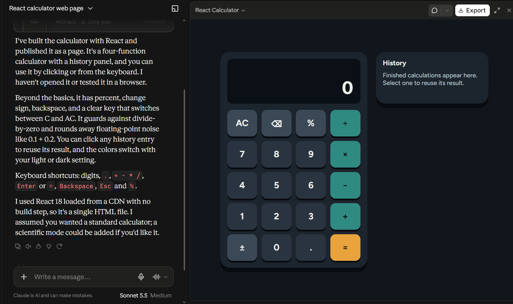
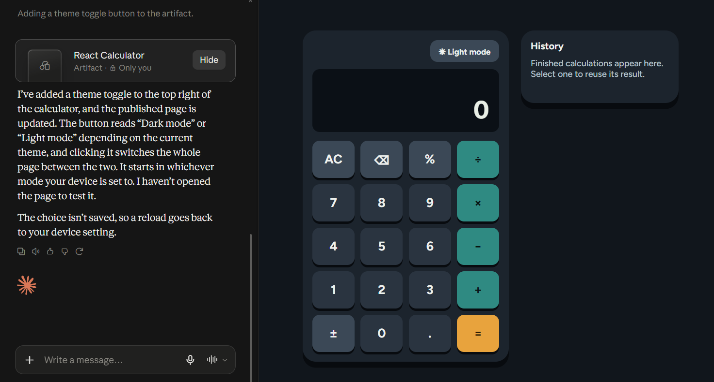

Research & Learn

What AI tools are typically used for your role?
- Copilot for the AI programming assist and real-time autocomplete suggestions, Claude for complex reasoning and generating technical documentation, ChatGPT for brainstorming and quick debugging.

What are the benefits and risks of using AI in a professional setting?
- Using AI in your work can greatly increased your productivity and efficiency. Some tasks can be automated and save the human resource and cost. On the flip side, there is a risk of data being exposed to public AI tools. AI also generate imperfect code or information so take it as fact without research and using it could be dangerous.

What types of information should never be entered into AI tools?
- Personal information, confidential data and code or corporate business plans.

How can you fact-check and validate AI-generated content to ensure accuracy?
- You can cross reference the facts with multiple AI or sources. Another way is prompting the AI to state their sources. Some AI like ChatGPT can make facts up and have no source to back it up.

Reflection

When should you use AI for assistance, and when should you rely on your own skills?
- You can use AI to help debug some problems or bugs. Our skills comes in when we need to make sure that the code and facts presented by the AI is valid and compatible to your system. If we just copy and paste a code from AI's suggestion without thoroughly checking, we might break the system even more.

How can you avoid over-reliance on AI while still benefiting from it?
- By using other type of ways to get information namely google searching. Google searching is different from AI suggestions because you are discovering the answers yourself as opposed to having the answers told to you. The balance of using your own skills, finding the answers on your own and asking AI complex questions that is hard to answer is needed from a modern programmer.

What steps will you take to ensure data privacy when using AI tools?
- Assume every inputs are public where conversations recorded. Use anonymous names, number or identifiers when using chatbots. Use an enterprise tier if possible which guarantees data privacy from AI provider.

Task

Identify one task you can improve using an AI tool, and try it out.
- Prototyping. I can ask the AI to quickly generate a prototype to show investors or clients. Not only that, I can get a headstart on developing the website using that prototype.

The prompt I gave to Claude:
- Generate a calculator web page using react

This is a caculator page I asked Claude to generate using React:

Below is what Claude returned in the messages:
- I've built the calculator with React and published it as a page. It's a four-function calculator with a history panel, and you can use it by clicking or from the keyboard. I haven't opened it or tested it in a browser.

Beyond the basics, it has percent, change sign, backspace, and a clear key that switches between C and AC. It guards against divide-by-zero and rounds away floating-point noise like 0.1 + 0.2. You can click any history entry to reuse its result, and the colors switch with your light or dark setting.

Keyboard shortcuts: digits, ., + - * /, Enter or =, Backspace, Esc and %.

I used React 18 loaded from a CDN with no build step, so it's a single HTML file. I assumed you wanted a standard calculator; a scientific mode could be added if you'd like it.

Review the AI-generated output critically; did it require editing or fact-checking?
- According to the output generated above, it is created in HTML instead of React. Therefore, I need to edit it into React before committing my codes. I also want an option to switch between light mode and dark mode. I will need to ask Claude to add the option to switch to light mode.

The prompt I gave to Claude:
- Add a button to switch to light mode and dark mode
The new version of caculator page:

Below is what Claude returned in the messages:
- I've added a theme toggle to the top right of the calculator, and the published page is updated. The button reads "Dark mode" or "Light mode" depending on the current theme, and clicking it switches the whole page between the two. It starts in whichever mode your device is set to. I haven't opened the page to test it.

The choice isn't saved, so a reload goes back to your device setting.

Document one best practice you will follow when using AI tools at Focus Bear.
- Assuming that every conversation with AI is recorded to an external party and be careful to not use confidential data when chatting with AI.