Research & Learn

Who are considered vulnerable populations, and what challenges might they face in digital spaces?
- Vulnerable populations are people who are neurodivergent. Neurodivergent individuals struggles with disctrations, cognitive and executive funtion load and sensory overload.

What ethical considerations are important when designing or working with neurodivergent individuals?
- When designing for neurodivergent individuals, we should avoid overwhelming UX, avoid coercive design patterns and implement design that makes them feel included. When working with neurodivergent individuals, we should respect their sensory needs, ensure clear and concise communication and treat them as equal instead of as people in need or lesser than ourselves.

How can you make interactions and content more accessible for people with ADHD or Autism?
- By reducing cognitive load, preventing sensory overload and make information more predictable.

How can we support neurodivergent team members in a professional setting?
- Show respect regardless of the differences in work styles, communicate clearly, allow flexobity and consideration for them.

Reflection

How can you adjust your communication style to be more inclusive of neurodivergent users and teammates?
- Avoid idioms or sarcasm because they might take it literally.
- Be clear and explicit when communicating because they might get confused.- Simplify information or use visual aids to help them to get a better picture of what you are saying.

What are some common UX or communication pitfalls that might make Focus Bear less accessible or supportive?
- I think the Focus Bear app assumes the user understood the functionality of the app or are able to find the tutorial which is hidden behind Help & Support. I feel that the tutorials should be more accessible and visible so the users can use it anytime they want.

What is one practical change you can make in your work to better support vulnerable populations?
- As a programmer, I should make a habit to write down comments in the code files explaining my code in a short and concise way.

Task

Read a first-person account from someone with ADHD or Autism about their experiences with productivity tools.
- URL to the blog post: https://troydigitalproduct.medium.com/i-quit-every-adhd-productivity-app-and-printed-one-sheet-of-paper-instead-9e6da3de48dd

Identify one design or communication improvement that could make Focus Bear more accessible.
- Make the tutorial more accessible, visible and efficient. For example, make a button on the top right of the app that shows a simple tutorial of what are the functions of the current page the user is at. The button should be an icon with an I and the colors should contrast the background of the page. This way, users are able see and click on the button to get access to the tutorial and understand the functions quickly.

Practice writing a clear, patient, and supportive response to a hypothetical user struggling with executive functioning.
- Hello there. Thank you reaching out to Focus Bear support.

If you are feeling stuck, overwhelmed or confused, this is natural. It happens to anyone and everyone regardless of circumstances will need help. Therefore, you are not alone.

According to the questions you have stated, you want to know how to edit what will be blocked by the Focus Bear app when you start a focus session.
Here is a step-to-step guide on how to do just that:
1) Left click the tab menu on your taskbar.
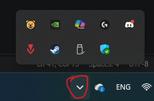
2) Left click the Focus Bear logo.
3) Left click on the setting button.
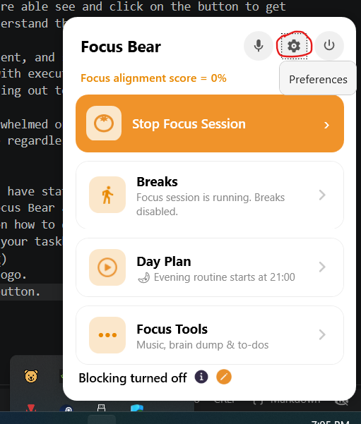
4) Left click on Blocking which is on the left hand side of the app.
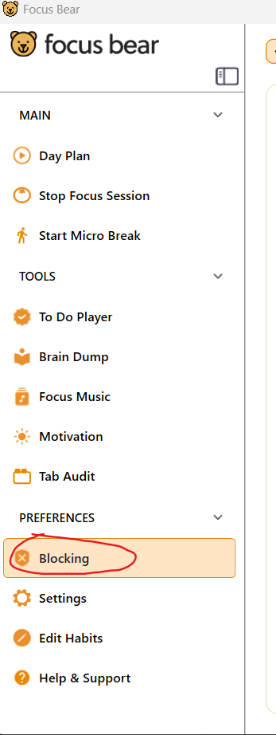
5) Left click on the block list you want to edit.
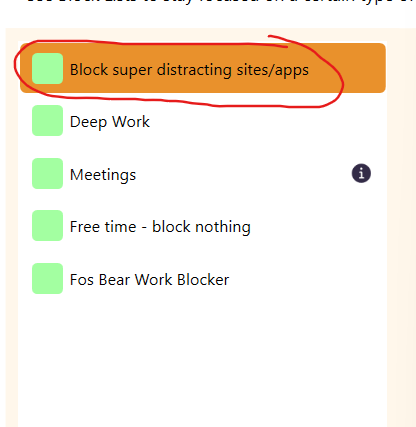
6) Left click on the + button to add a app you want to block.
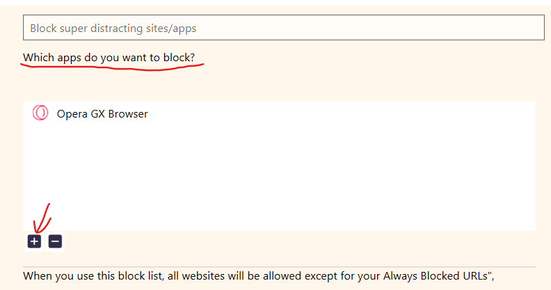
7) Left click on the app you want to block and press add.
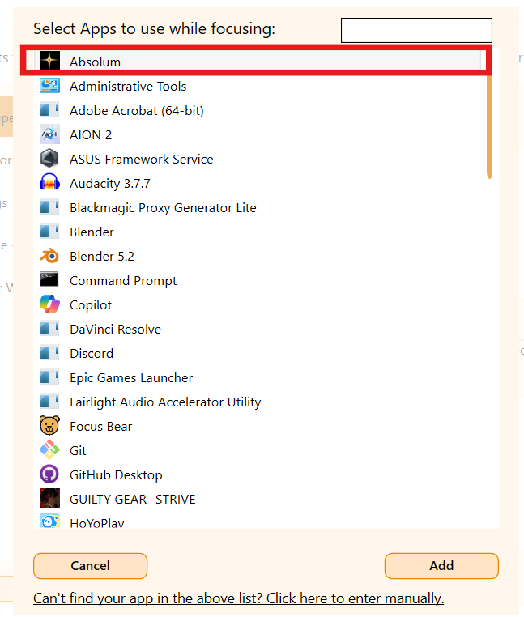
8) Left click on the app you don't want to block and press - button to remove it from the list.
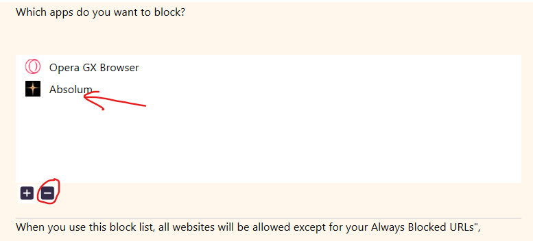
9) Press + to add a website you want to block.
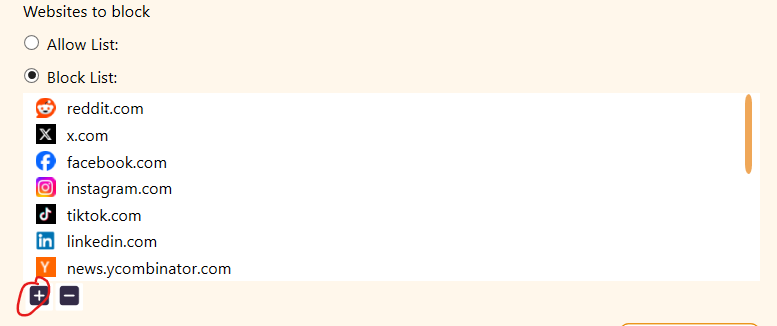
10) Paste a the URL for the website you want to block and press add.
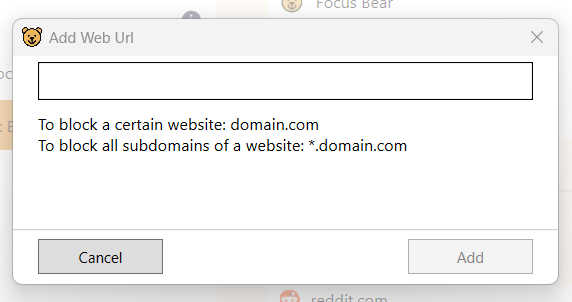
11) Left click on the website you don't want to block and press - button to remove it from the list.
12) Press the radio button on Allow list to edit the website that is not block.
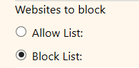

If you are still confused, you can click on Help & Support on the bottom left side of the app which will give you access to the tutorials for this app.
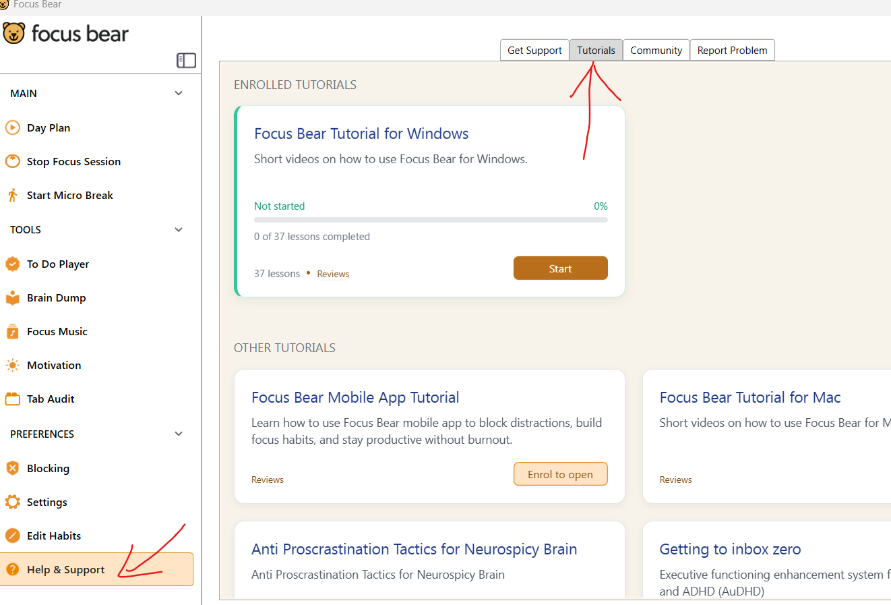

You don't have to fix everything today—just focus on the next smallest step. You've got this!