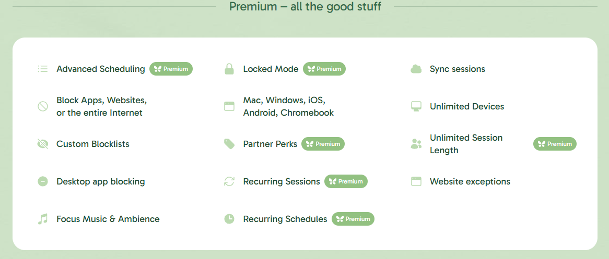
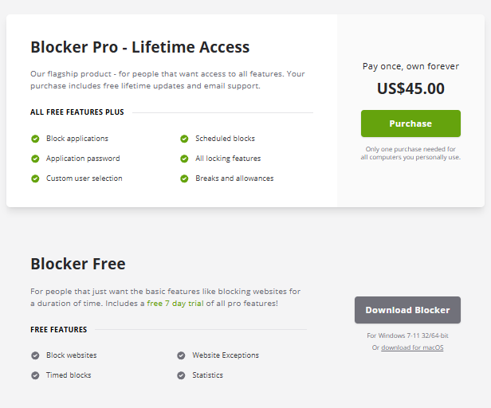
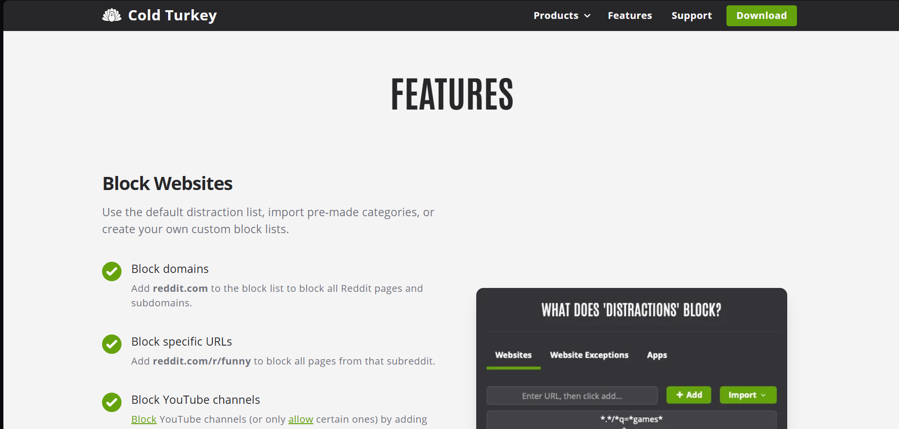
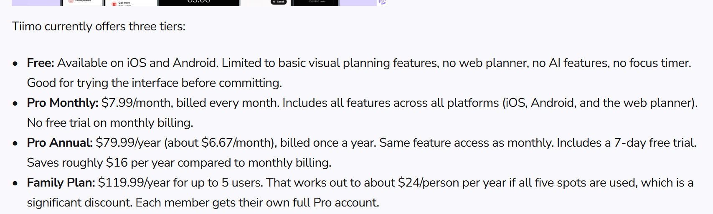
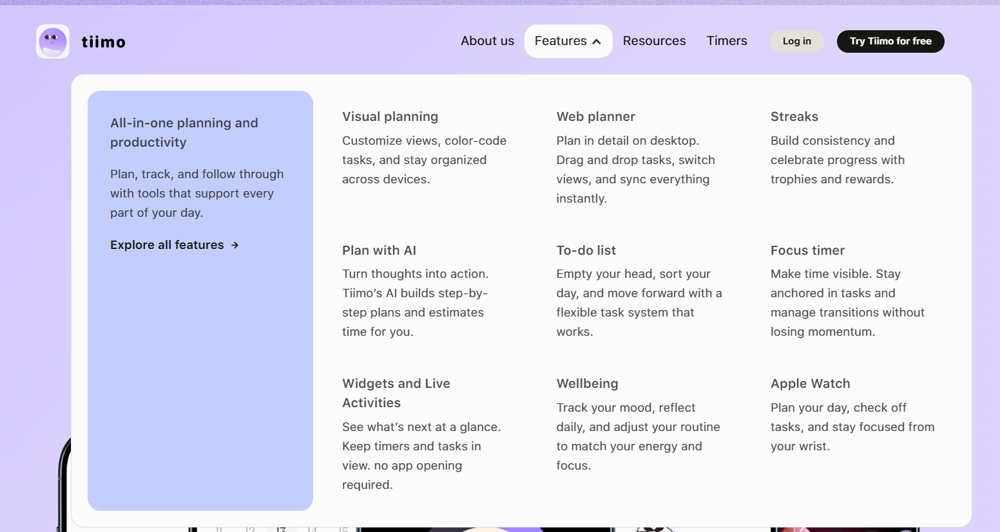
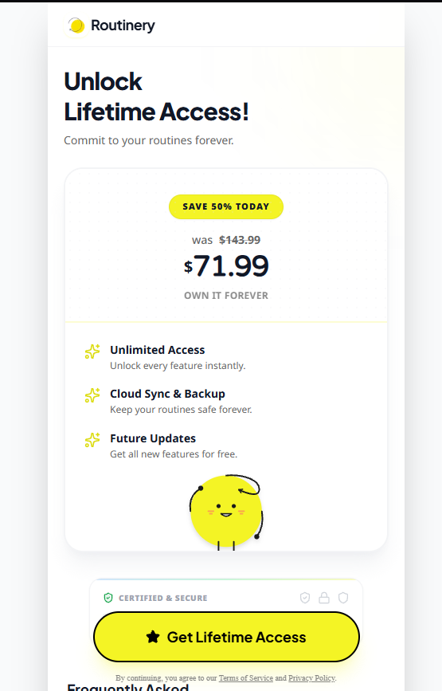
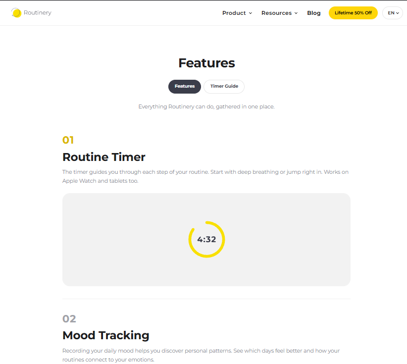

Competitive landscape

Competitors:
Freedom
- Source links
    - Main product page: https://freedom.to
    - Pricing page: https://freedom.to/upgrade
    - Feature page: https://freedom.to/features
- Pricing    
    - Free: free 
    - Monthly payment: $8.99 per month
    - Yearly payment: $39.99 per year
    - Lifetime access: $99.50 on 50% discount from $199 one time payment
- Platform: Mac, Windows, Android, iOS, Chromebook, Linux
- Standout features: Blocking websites and apps during focus sessions.

Cold Turkey
- Source links
    - Main product page: https://getcoldturkey.com
    - Pricing page: https://getcoldturkey.com/pricing/
    - Features page: https://getcoldturkey.com/features/
-Pricing:
    - Blocker free: Free
    - Blocker Pro: $59.00 one time payment
- Platform: Available on Mac, Windows
- Standout features: Blocking websites, apps and devices during focus sessions.

Tiimo
- Source links
    - Main source page: https://www.tiimoapp.com
    - Google Play App store listing page: https://play.google.com/store/apps/details?id=com.tiimo.androidappreactnative&hl=en
    - Features page: https://www.tiimoapp.com/product
- Pricing: 
    - Free: Free but only in mobile
    - Pro Monthly: $7.99 per month
    - Pro Annual: $79.99 per year
    - Family Plan: $119.99 per year, up to 5 users
- Platform: Web, Android, iOS, watchOS, iPadOS
- Standout features: Schedule planner with visuals and AI assistant.

Routinery
- Source links
    - Main source page: https://www.routinery.app
    - Pricing page: https://web-to-app.routinery.app/unlock-lifetime-access
    - Features page: https://www.routinery.app/features
- Pricing:
    - Free: Free trial for 30 days
    - Lifetime access: $71.99 50% discount from $143.99 one time payment
- Platform: Android, iOS
- Standout features: Routine planner apps that trains habits

What makes Focus Bear different from these apps?
- These apps specialize in one kind of main feature while Focus Bear includes several core features in one app. These apps are able to expand on their one main feature and add many quality of life features to support the main feature. Focus Bear doesn't specialize in just one feature. Focus Bear has distraction blocking, habit routines, to do list and breaks. Each of the features is useful but doesn't expand on them too much.

If you were a user, why would you choose Focus Bear over competitors?
- I would choose Focus Bear because it has all of the main features from the competitors in one place. I can use the habit routine planning feature and use the focus session if I want to. I don't have to download two apps for different functions but I am not pressured to use one function over the other if I don't want to.

What's one feature that other apps have that Focus Bear doesn't?
- A cool feature I see from some competitors is that Tiimo and Routinery have a feature where users can setup a widget on their phone to see the tasks to do, streaks or focus timer. I think Focus Bear mobile app could benefit from that.

Based on your research, what's one improvement you think Focus Bear could make?
- One thing I found in common in all the competitors' product is that they are very simple to process and easy to use. Even just from the pictures alone, I can immediately tell what that function is. The other apps have one main feature so it would be easier to simplify. In Focus Bear, I had a hard time understanding what the different terms mean, what the different functions do and how to swiftly control the focus session, habit routine and breaks. It took me some time to fully understand the features but navigating around the app is not as intuitive as the other apps. There are tutorials but they are hidden behind 'Help & Support' which is at the bottom-left corner of the app. That makes it unlikely to be clicked. Average users especially those who have ADHD wouldn't care to click on tutorials, much less if they are hidden.

Comparison between apps

Ease of use (The simplicity and intuitivity when using the app)
- Focus Bear:
    - Takes a bit of time to understand the main features and use. The dashboard groups multiple complex settings (distractions, habits, breaks) together, and the setup tutorials are hidden in the bottom-left "Help & Support" menu.
- Freedom:
    - Easy to understand and use quickly. This is evident from the Freedom feature page , which highlights an ultra-minimalist web dashboard with a single primary CTA button to "Start a Session" right away without extra setup steps.
- Cold Turkey:
    - Easy to understand and use quickly. The proof is visible in the Cold Turkey features page , which showcases a clean, native software layout relying on unmistakable left-hand navigation tabs specifically separating "Blocks" and "Timers."
- Tiimo:
    - Easy to understand and use quickly. As shown on the Tiimo features page layout , the app reduces cognitive overload by relying entirely on a highly visual daily timeline populated with colorful, glanceable icons for tasks.
- Routinery:
    - Takes a bit of time to understand and use. Looking at the Routinery features page overview , the application introduces added layout complexity because it places heavy tracking metrics, streak charts, and secondary configuration toggles on the main interface.
